# Event-Based Self-Checkout Architecture

The deployment of feature 006 (`specs/006-event-based-architecture`): three microservices behind one Nginx gateway, each with its own MySQL schema, exchanging domain events only through one Apache Kafka broker. No service calls another; every inter-service arrow below starts or ends at a topic. The diagram follows the [event catalog](../../specs/006-event-based-architecture/contracts/event-catalog.md), and `server/tests/architecture/ArchitectureDiagramConsistencyTest` checks that the two agree.

An exported copy for viewers outside GitHub is [event-based-architecture.svg](event-based-architecture.svg).

```mermaid
flowchart LR
    client(["Load Client and station clients"])
    gateway["Nginx API gateway<br/>:8080<br/>public REST contract"]

    transaction["Transaction Service<br/>:8081<br/>transactions, scans, checkout Saga"]
    inventory["Inventory Service<br/>:8082<br/>catalog and stock"]
    analytics["Analytics Service<br/>:8083<br/>popular items"]

    subgraph txdb ["MySQL schema cs6510_transaction"]
        tx_state[("transaction, checkout_attempt")]
        tx_scans[("accepted_scan<br/>scan relay source")]
        tx_replica[("product_replica, product_replica_meta")]
        tx_outbox[("outbox_event")]
        tx_dead[("dead_letter_event")]
    end

    subgraph invdb ["MySQL schema cs6510_inventory"]
        inv_state[("catalog_item, catalog_meta, inventory")]
        inv_ops[("checkout_operation")]
        inv_outbox[("outbox_event")]
        inv_dead[("dead_letter_event")]
    end

    subgraph andb ["MySQL schema cs6510_analytics"]
        an_state[("accepted_scan, scan_sequence, product_name")]
        an_windows[("popular_window, popular_item, analytics_checkpoint")]
        an_offset[("consumer_offset")]
        an_dead[("dead_letter_event")]
    end

    subgraph broker ["Apache Kafka 4.1.0 broker, KRaft, 127.0.0.1:19092"]
        t_catalog[["selfcheckout.catalog.v1<br/>1 partition, compacted, key SKU"]]
        t_checkout[["selfcheckout.checkout.v1<br/>16 partitions, key transaction ID"]]
        t_outcome[["selfcheckout.checkout-outcome.v1<br/>16 partitions, key transaction ID"]]
        t_scans[["selfcheckout.scan-accepted.v1<br/>1 partition, key transaction ID"]]
    end

    client -->|"HTTP"| gateway
    gateway -->|"/transactions, /transactions/*"| transaction
    gateway -->|"/items, /inventory/low-stock"| inventory
    gateway -->|"/analytics/popular-items"| analytics

    transaction -->|"JDBC, own user"| txdb
    inventory -->|"JDBC, own user"| invdb
    analytics -->|"JDBC, own user"| andb

    transaction -->|"CheckoutRequested<br/>StockRestorationRequested (reserved)<br/>from outbox_event"| t_checkout
    transaction -->|"ScanAccepted<br/>relayed from accepted_scan"| t_scans
    inventory -->|"CatalogItemPublished<br/>CatalogSnapshotPublished<br/>from outbox_event"| t_catalog
    inventory -->|"StockDeducted, StockRejected, StockDeductionRefused<br/>StockRestored (reserved), RestorationNotNeeded (reserved)<br/>from outbox_event"| t_outcome

    t_checkout -->|"group inventory-checkout, 8 threads<br/>CheckoutRequested<br/>StockRestorationRequested (reserved)"| inventory
    t_outcome -->|"group transaction-checkout-outcome, 8 threads<br/>StockDeducted, StockRejected, StockDeductionRefused<br/>StockRestored (reserved), RestorationNotNeeded (reserved)"| transaction
    t_catalog -->|"manual assignment, replay from offset 0<br/>CatalogItemPublished<br/>CatalogSnapshotPublished"| transaction
    t_scans -->|"group analytics-scan-ingest, 1 thread<br/>ScanAccepted"| analytics

    classDef service fill:#dbeafe,stroke:#1d4ed8,color:#0f172a
    classDef topic fill:#fef3c7,stroke:#b45309,color:#0f172a
    classDef table fill:#f1f5f9,stroke:#475569,color:#0f172a
    classDef edge fill:#e2e8f0,stroke:#334155,color:#0f172a
    class transaction,inventory,analytics service
    class t_catalog,t_checkout,t_outcome,t_scans topic
    class tx_state,tx_scans,tx_replica,tx_outbox,tx_dead,inv_state,inv_ops,inv_outbox,inv_dead,an_state,an_windows,an_offset,an_dead table
    class client,gateway edge
```



## Legend

| Shape or arrow | Meaning |
|---|---|
| Blue box | A microservice process. The port is its own HTTP port, reached only through the gateway. |
| Cylinder inside a schema | Tables of that service's own MySQL schema. No service user can read another service's schema. |
| Yellow box inside the broker | A Kafka topic with its partition count and record key. |
| Service → topic | The service is the only producer of the listed event types. Each event is first written to `outbox_event` (or, for scans, `accepted_scan`) in the service's local transaction, then published by its dispatcher or scan relay. |
| Topic → service | The consuming service, with its consumer group (or the catalog replica's manual assignment) and the event types it handles. An offset is committed only after the handler's local transaction commits. |
| `dead_letter_event` | Where each consuming service parks a message that failed permanently. |
| `(reserved)` | Types whose format is defined and handled, but which only direct tests produce. |

Every synchronous internal link of feature 005 (gRPC) is gone; the gateway's routes are the only HTTP paths, and they carry only the public contract.

## Regenerating the SVG

The SVG is exported with Mermaid CLI `@mermaid-js/mermaid-cli@11.17.0` (pinned). It was rendered with the locally installed Chrome, through a Puppeteer config file outside the repository that holds only `{"executablePath": "<path to chrome.exe>"}`, so that no browser is downloaded. From the repository root:

```powershell
$env:PUPPETEER_SKIP_DOWNLOAD = 'true'
npx -y @mermaid-js/mermaid-cli@11.17.0 -i docs/architecture/event-based-architecture.md -o $env:TEMP/event-based-architecture.svg -p <puppeteer-config.json> -b white
Move-Item -Force $env:TEMP/event-based-architecture-1.svg docs/architecture/event-based-architecture.svg
```

When given a Markdown input, the CLI writes one numbered SVG per `mermaid` block. Without `-p` and `PUPPETEER_SKIP_DOWNLOAD`, Puppeteer downloads its own browser. Export the SVG again after every change to the diagram. The consistency test fails when the SVG is older than this page.
