# Self-Checkout Architecture with the Notification Service

The deployment of feature 007 (`specs/007-notification-service`): feature 006's three microservices plus the Notification Service, behind one Nginx gateway. Each service has its own MySQL schema, and they exchange domain events only through one Apache Kafka broker. No service calls another; every inter-service arrow below starts or ends at a topic. Transaction records each completed sale's `SaleCompleted` event in its outbox. Notification selects the subscribers of each sold SKU and publishes one `SubscriberNotified` event to each subscriber's own channel topic. The subscriber test application reads those channels; the unchanged Load Client drives checkout.

The diagram follows the [006 event catalog](../../specs/006-event-based-architecture/contracts/event-catalog.md) and the [007 sale event contract](../../specs/007-notification-service/contracts/sale-completed-event.md). `server/tests/architecture/ArchitectureDiagramConsistencyTest` checks that it agrees with `TopicNames`, `EventTypes`, `deploy/nginx.conf`, and each service's `schema.sql`. Feature 006's diagram, without Notification, stays in [event-based-architecture.md](event-based-architecture.md).

An exported copy for viewers outside GitHub is [notification-service.svg](notification-service.svg).

```mermaid
flowchart LR
    client(["Load Client, unchanged<br/>10 or 100 stations"])
    subscribers(["Subscriber test application<br/>SubscriberMain, N subscriber threads<br/>receipts and reconciliation"])
    gateway["Nginx API gateway<br/>:8080<br/>public REST contract and /notifications/"]

    transaction["Transaction Service<br/>:8081<br/>transactions, scans, checkout Saga"]
    inventory["Inventory Service<br/>:8082<br/>catalog and stock"]
    analytics["Analytics Service<br/>:8083<br/>popular items"]
    notification["Notification Service<br/>:8084<br/>subscriptions, selection, delivery"]

    subgraph txdb ["MySQL schema cs6510_transaction"]
        tx_state[("transaction, checkout_attempt")]
        tx_scans[("accepted_scan<br/>scan relay source")]
        tx_replica[("product_replica, product_replica_meta")]
        tx_outbox[("outbox_event<br/>with SaleCompleted rows")]
        tx_dead[("dead_letter_event")]
    end

    subgraph invdb ["MySQL schema cs6510_inventory"]
        inv_state[("catalog_item, catalog_meta, inventory")]
        inv_ops[("checkout_operation")]
        inv_outbox[("outbox_event")]
        inv_dead[("dead_letter_event")]
    end

    subgraph andb ["MySQL schema cs6510_analytics"]
        an_state[("accepted_scan, scan_sequence, product_name")]
        an_windows[("popular_window, popular_item, analytics_checkpoint")]
        an_offset[("consumer_offset")]
        an_dead[("dead_letter_event")]
    end

    subgraph ntdb ["MySQL schema cs6510_notification"]
        nt_subs[("subscription_clock, subscriber, subscription, subscription_change")]
        nt_selection[("sale_selection")]
        nt_rows[("notification<br/>delivery source")]
        nt_dead[("dead_letter_event")]
    end

    subgraph broker ["Apache Kafka 4.1.0 broker, KRaft, 127.0.0.1:19092"]
        t_catalog[["selfcheckout.catalog.v1<br/>1 partition, compacted, key SKU"]]
        t_checkout[["selfcheckout.checkout.v1<br/>16 partitions, key transaction ID"]]
        t_outcome[["selfcheckout.checkout-outcome.v1<br/>16 partitions, key transaction ID"]]
        t_scans[["selfcheckout.scan-accepted.v1<br/>1 partition, key transaction ID"]]
        t_sales[["selfcheckout.sale-completed.v1<br/>16 partitions, key transaction ID"]]
        t_channels[["selfcheckout.notify.#lt;subscriberId#gt;.v1<br/>one topic per subscriber, 1 partition, key subscriber ID"]]
    end

    client -->|"HTTP"| gateway
    subscribers -->|"HTTP POST /notifications/subscribers<br/>registration before the load"| gateway
    gateway -->|"/transactions, /transactions/*"| transaction
    gateway -->|"/items, /inventory/low-stock"| inventory
    gateway -->|"/analytics/popular-items"| analytics
    gateway -->|"/notifications/*"| notification

    transaction -->|"JDBC, own user"| txdb
    inventory -->|"JDBC, own user"| invdb
    analytics -->|"JDBC, own user"| andb
    notification -->|"JDBC, own DML-only user"| ntdb

    transaction -->|"CheckoutRequested<br/>StockRestorationRequested (reserved)<br/>from outbox_event"| t_checkout
    transaction -->|"ScanAccepted<br/>relayed from accepted_scan"| t_scans
    transaction -->|"SaleCompleted<br/>from outbox_event, written in the sale's own commit"| t_sales
    inventory -->|"CatalogItemPublished<br/>CatalogSnapshotPublished<br/>from outbox_event"| t_catalog
    inventory -->|"StockDeducted, StockRejected, StockDeductionRefused<br/>StockRestored (reserved), RestorationNotNeeded (reserved)<br/>from outbox_event"| t_outcome
    notification -->|"SubscriberNotified<br/>from the notification table, one lane per channel"| t_channels

    t_checkout -->|"group inventory-checkout, 8 threads<br/>CheckoutRequested<br/>StockRestorationRequested (reserved)"| inventory
    t_outcome -->|"group transaction-checkout-outcome, 8 threads<br/>StockDeducted, StockRejected, StockDeductionRefused<br/>StockRestored (reserved), RestorationNotNeeded (reserved)"| transaction
    t_catalog -->|"manual assignment, replay from offset 0<br/>CatalogItemPublished<br/>CatalogSnapshotPublished"| transaction
    t_catalog -->|"manual assignment, replay from offset 0<br/>CatalogItemPublished<br/>CatalogSnapshotPublished<br/>known SKUs"| notification
    t_scans -->|"group analytics-scan-ingest, 1 thread<br/>ScanAccepted"| analytics
    t_sales -->|"group notification-sale-completed, 4 threads<br/>SaleCompleted"| notification
    t_channels -->|"manual assignment, one thread per subscriber<br/>SubscriberNotified"| subscribers

    classDef service fill:#dbeafe,stroke:#1d4ed8,color:#0f172a
    classDef topic fill:#fef3c7,stroke:#b45309,color:#0f172a
    classDef channel fill:#fde68a,stroke:#b45309,color:#0f172a
    classDef table fill:#f1f5f9,stroke:#475569,color:#0f172a
    classDef edge fill:#e2e8f0,stroke:#334155,color:#0f172a
    class transaction,inventory,analytics,notification service
    class t_catalog,t_checkout,t_outcome,t_scans,t_sales topic
    class t_channels channel
    class tx_state,tx_scans,tx_replica,tx_outbox,tx_dead,inv_state,inv_ops,inv_outbox,inv_dead,an_state,an_windows,an_offset,an_dead,nt_subs,nt_selection,nt_rows,nt_dead table
    class client,subscribers,gateway edge
```



## Legend

| Shape or arrow | Meaning |
|---|---|
| Blue box | A microservice process. The port is its own HTTP port, reached only through the gateway. |
| Cylinder inside a schema | Tables of that service's own MySQL schema. No service user can read another service's schema, and Notification's user can only read and write rows. |
| Yellow box inside the broker | A fixed Kafka topic with its partition count and record key. |
| Darker yellow box | The channel family: one topic per registered subscriber, which Notification creates at registration and the baseline reset removes. |
| Service → topic | The service is the only producer of the listed event types. Each event is first written to `outbox_event` (or, for scans, `accepted_scan`; for notifications, the `notification` table) in the service's local transaction, then published by its dispatcher. |
| Topic → service | The consuming service, with its consumer group (or the manual assignment of a catalog reader) and the event types it handles. An offset is committed only after the handler's local transaction commits. |
| Channel → subscriber test application | One thread per subscriber reads its channel by manual assignment and records receipts, keeping the first copy of each notification ID. |
| `dead_letter_event` | Where each consuming service parks a message that failed permanently. |
| `(reserved)` | Types whose format is defined and handled, but which only direct tests produce. |

The only HTTP paths are the gateway's routes. The Load Client uses the seven public routes of 006, and the subscriber test application registers subscribers through `/notifications/`. No service calls another service, and checkout never waits for Notification.

## Regenerating the SVG

The SVG is exported the same way as feature 006's, with Mermaid CLI `@mermaid-js/mermaid-cli@11.17.0` (pinned) and the locally installed Chrome, through a Puppeteer config file outside the repository that holds only `{"executablePath": "<path to chrome.exe>"}`. From the repository root:

```powershell
$env:PUPPETEER_SKIP_DOWNLOAD = 'true'
npx -y @mermaid-js/mermaid-cli@11.17.0 -i docs/architecture/notification-service.md -o $env:TEMP/notification-service.svg -p <puppeteer-config.json> -b white
Move-Item -Force $env:TEMP/notification-service-1.svg docs/architecture/notification-service.svg
```

Export the SVG again after every change to the diagram. The consistency test fails when the SVG is older than this page.
